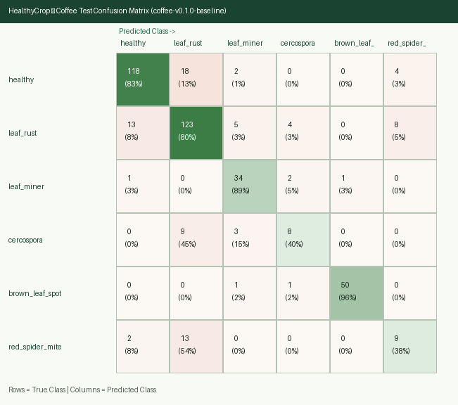

# HealthyCrop — ML Experiments Log

This document records all training, hyperparameter, ablation, and quantization experiments across Phases 1, 2, and 5.

---

## 1. Experimental Protocol

- **Fixed Random Seed**: `42` across Python `random`, `numpy`, `scikit-learn` splitters, and `tensorflow`.
- **Data Split**: `70%` train / `15%` validation / `15%` test, grouped by `group_id` and stratified by class label after cross-source perceptual-hash deduplication.
- **Input Resolution**: `224 x 224 x 3` RGB.
- **Augmentation Pipeline (Train Only)**:
  - Random horizontal and vertical flips
  - Random rotation (`±15°`)
  - Random brightness and contrast adjustment (`±15%`)
  - Random zoom / crop (`85%–100%` area)
- **Imbalance Handling**: Balanced class weights computed on the `train` split (`sklearn.utils.class_weight.compute_class_weight`). Any class with `< 50` training images is evaluated for merging prior to training.
- **Primary Selection Metric**: **Validation Macro-F1** (used for early stopping and checkpoint selection).
- **Acceptance Targets**:
  - Test Macro-F1 `>= 0.80` (if `< 0.80`, document root causes, confusion pairs, and all attempted mitigations).
  - Float16 TFLite test accuracy within `<= 1.0` percentage point of the Keras checkpoint, file size `< 10 MB`.

---

## 2. Summary of Runs

| Run ID | Phase | Crop | Stage / Variant | Backbone Unfrozen Layers | LR (Head / Fine-Tune) | Epochs (Stopped) | Val Macro-F1 | Test Macro-F1 | Test Acc (Keras / TFLite) | TFLite Size | Notes |
| :--- | :--- | :--- | :--- | :--- | :--- | :--- | :--- | :--- | :--- | :--- | :--- |
| `coffee-v0.1.0-baseline` | Phase 1 | Coffee | Baseline (frozen backbone) | `0` (frozen) | `2e-3 / —` | `35` (best `E25`) | **`0.7637`** | **`0.7135`** | `79.72% / —` | — | Initial frozen `MobileNetV3-Large` baseline (`#16`) |
| `coffee-v0.1.0-finetuned` | Phase 2 | Coffee | Fine-tuned top blocks | *Pending* | `2e-3 / 1e-4` | *Pending* | *Pending* | *Pending* | *Pending* | *Pending* | Float16 TFLite export candidate (`#17`) |
| `cacao-001` | Phase 5 | Cacao | Baseline (frozen backbone) | `0` (frozen) | `1e-3 / —` | *Pending* | *Pending* | *Pending* | *Pending* | — | Initial frozen `MobileNetV3-Large` baseline |
| `cacao-002` | Phase 5 | Cacao | Fine-tuned top blocks | *Pending* | `1e-3 / 1e-4` | *Pending* | *Pending* | *Pending* | *Pending* | *Pending* | Float16 TFLite export candidate |
| `banana-001` | Phase 5 | Banana | Baseline (frozen backbone) | `0` (frozen) | `1e-3 / —` | *Pending* | *Pending* | *Pending* | *Pending* | — | Initial frozen `MobileNetV3-Large` baseline |
| `banana-002` | Phase 5 | Banana | Fine-tuned top blocks | *Pending* | `1e-3 / 1e-4` | *Pending* | *Pending* | *Pending* | *Pending* | *Pending* | Float16 TFLite export candidate |

---

## 3. Detailed Run Logs & Confusion Matrices

### 3.1 `coffee-v0.1.0-baseline` — Phase 1 Frozen `MobileNetV3-Large` Baseline (`2026-10-16`)

- **Architecture**: `MobileNetV3Large(input_shape=(224, 224, 3), include_top=False, include_preprocessing=False, weights="imagenet", pooling="avg")` (`0` backbone layers unfrozen) -> `LayerNormalization` -> `Dropout(0.25)` -> `Dense(6, activation="softmax", kernel_regularizer=L2(1e-4))`.
- **Dataset Split**: `train = 1,969` (`+ 1,969` augmented views), `val = 426`, `test = 429` (`seed = 42`, zero `group_id` overlap across splits).
- **Training Configuration**: Adam (`lr = 2e-3`), `batch_size = 64`, inverse-frequency balanced class weights, early stopping (`patience = 10` on validation `macro-F1`, best checkpoint restored from epoch `25`).
- **Overall Metrics**:
  - **Validation**: Accuracy = **`82.16%`** (`0.8216`), Macro-Precision = `0.8083`, Macro-Recall = `0.7431`, **Macro-F1 = `0.7637`**.
  - **Held-Out Test (`n = 429`)**: Accuracy = **`79.72%`** (`0.7972`), Macro-Precision = `0.7222`, Macro-Recall = `0.7110`, **Macro-F1 = `0.7135`**.

#### Held-Out Test Per-Class Metrics (`coffee-v0.1.0-baseline`)

| Class (`label`) | Precision | Recall | F1-Score | Test Support |
|---|---:|---:|---:|---:|
| `healthy` | `0.8806` | `0.8310` | **`0.8551`** | `142` |
| `leaf_rust` | `0.7546` | `0.8039` | **`0.7785`** | `153` |
| `leaf_miner` | `0.7556` | `0.8947` | **`0.8193`** | `38` |
| `cercospora` | `0.5333` | `0.4000` | **`0.4571`** | `20` |
| `brown_leaf_spot` | `0.9804` | `0.9615` | **`0.9709`** | `52` |
| `red_spider_mite` | `0.4286` | `0.3750` | **`0.4000`** | `24` |
| **Macro Average** | **`0.7222`** | **`0.7110`** | **`0.7135`** | **`429`** |

#### Error Analysis & Motivation for Phase 2 Fine-Tuning (`#17`)
- With the `MobileNetV3-Large` backbone completely frozen at ImageNet weights, macro-scale lesion morphologies (`brown_leaf_spot` F1 `0.9709`, `healthy` F1 `0.8551`, `leaf_miner` F1 `0.8193`, `leaf_rust` F1 `0.7785`) are already well separated (`79.72%` overall test accuracy).
- However, fine-grained surface stippling (`red_spider_mite`, F1 `0.4000`, where `13/24` test leaves were misclassified as `leaf_rust`) and small necrotic eye-spots (`cercospora`, F1 `0.4571`, where `9/20` were misclassified as `leaf_rust`) require domain-specific spatial filter adaptation in the top inverted residual blocks of `MobileNetV3-Large` during Phase 2 (`#17`).

