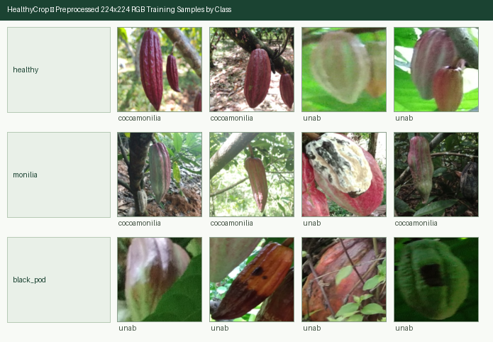

# Cacao Pod Disease Dataset Report (`Phase 5`)

## 1. Executive Summary

- **Target Crop**: Cacao (*Theobroma cacao*)
- **Sources Combined**: **CocoaMoniliaDataSet** (`10.5281/zenodo.17156051`, CC BY 4.0) + **UNAB Cocoa Diseases** (ODbL v1.0 / © Original Authors, YOLOv4 bounding-box pod crops)
- **Total Candidate Pods Extracted**: `2651`
- **Unmapped / Low-Quality Labels Excluded**: `0`
- **Unreadable / Corrupt Crops Dropped**: `0`
- **Near-Duplicates Removed (`imagehash.phash`, Hamming distance <= `2`)**: `5`
- **Final Clean Preprocessed Images (`224x224` RGB)**: **`2646`** across **`1367`** distinct tree/photograph `group_id`s
- **Zero `group_id` Overlap Across Splits (`train` / `val` / `test`)**: **`True`** (`seed=42`)

---

## 2. Per-Class Split & Source Distribution

| Class (`label`) | Train (`70%`) | Val (`15%`) | Test (`15%`) | Total Images | Distinct `group_id`s | CocoaMonilia | UNAB |
|---|---:|---:|---:|---:|---:|---:|---:|
| `healthy` | 1282 | 294 | 287 | **1863** | 901 | 644 | 1219 |
| `monilia` | 393 | 81 | 82 | **556** | 534 | 411 | 145 |
| `black_pod` | 168 | 29 | 30 | **227** | 164 | 0 | 227 |
| **Total** | **1843** | **404** | **399** | **2646** | **1367** | **1055** | **1591** |

---

## 3. Monilia Infection Stage Distribution (`severity` Metadata)

CocoaMoniliaDataSet annotates ordinal stages for monilia (*Moniliophthora roreri*):
- `severity = 0`: Healthy pod (`h0`)
- `severity = 1`: Stage 1 / Early oily/yellowish spot (`m1`)
- `severity = 2`: Stage 2 / Chocolate spot & necrosis (`m2`)
- `severity = 3`: Stage 3 / Sporulation / white mycelial felt (`m3`)

| Severity Level | Train | Val | Test | Total |
|---|---:|---:|---:|---:|
| Severity `1` | 266 | 56 | 50 | **372** |
| Severity `2` | 80 | 19 | 20 | **119** |
| Severity `3` | 47 | 6 | 12 | **65** |

---

## 4. Small-Class Merging Evaluation (`< 50` Training Images Rule)

- **Minimum Training Image Threshold**: `50` images in `train` split.
- **Primary Classes Below Threshold**: **None (all 3 primary classes exceed 50 training images)**.
- **Taxonomy Design**: Monilia stages `m1`-`m3` are consolidated under the primary `monilia` class to provide robust classification, while stage numbers are retained in the `severity` metadata for agronomic guidance.

---

## 5. Perceptual-Hash Deduplication & Grouped Leakage Prevention

- Perceptual hashes (`imagehash.phash`, Hamming distance `<= 2`) removed **`5` duplicate samples**.
- **UNAB Pod Grouping**: Multiple pods cropped from the same tree photograph share `group_id = unab_<image_stem>`, ensuring no multi-pod parent image leaks across `train`, `val`, and `test` splits.

---

## 6. Preprocessed Sample Grid (`224x224` RGB)

